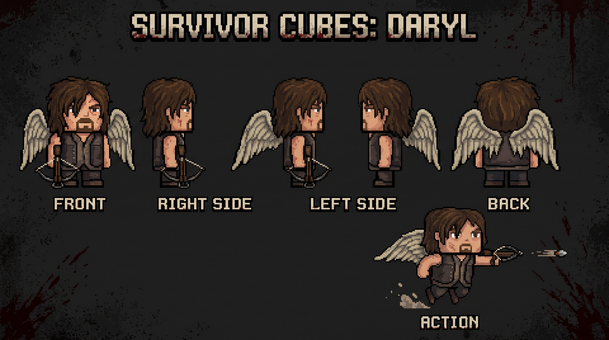
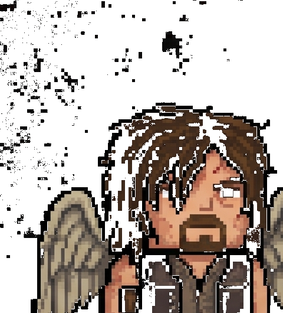

# El Eco de las Alas

**Examen: Game Design Document (GDD)**

**Integrante:** Katiuska Lita · **Modalidad:** individual

**Roles:** diseño, programación, integración de recursos y pruebas

**Versión:** 1.0 · **Estado:** prototipo funcional · **Fecha:** 28 de noviembre de 2026

## 1. Portada y ficha técnica — High Concept

| Campo | Definición |
|---|---|
| Título | El Eco de las Alas |
| Género | Aventura narrativa 2D con desplazamiento lateral |
| Plataforma | Navegador de escritorio; GitHub Pages e itch.io |
| Público objetivo | Adolescentes y adultos interesados en narrativa de personajes; recomendación temática 13+ |
| Estilo visual | Sprites pixel art sobre escenarios geométricos oscuros y paletas por capítulo |
| Motor y lenguaje | Phaser 4, JavaScript y Vite |
| Modo | Un jugador; sesiones breves y sin competencia |

**Elevator pitch:** En un mundo marcado por la pérdida, acompaña a Daryl Dixon a través de cinco capítulos de su vida. Recorre cada escenario, encuentra tres recuerdos y descubre cómo el aislamiento puede transformarse en vínculo y aceptación.

## 2. Pilares de diseño y experiencia — MDA

### Pilares (reglas innegociables)

1. **La historia guía la interacción:** cada objetivo jugable conduce a un recuerdo y a una reflexión del capítulo.
2. **Exploración sin presión:** el recorrido no usa cronómetro, puntuación, combate ni penalizaciones por avanzar despacio.
3. **Progresión emocional clara:** los cinco capítulos recorren aislamiento, esperanza, vulnerabilidad, duelo y aceptación.

### Estética y emoción buscadas

La estética (Aesthetics) prioriza contemplación, curiosidad y empatía. El jugador debe sentir que explora un espacio silencioso, identifica recuerdos y comprende gradualmente el cambio emocional del protagonista. La tensión es psicológica y temática; el prototipo no contiene persecuciones, sustos interactivos ni enemigos.

| MDA | Aplicación en el juego |
|---|---|
| Mecánicas | Caminar, acercarse a recuerdos, abrir diálogos y completar capítulos |
| Dinámicas | Explorar el nivel, localizar los tres puntos y leer en el orden elegido |
| Estéticas | Narrativa, descubrimiento, calma y empatía |

## 3. Core loop y mecánicas

### Diagrama del bucle principal

```text
ELEGIR CAPÍTULO → EXPLORAR EL ESCENARIO → ENCONTRAR UN RECUERDO
        ↑                                      ↓
MENÚ ← CIERRE DEL CAPÍTULO ← LEER Y CERRAR (repetir hasta 3/3)
```

En cada capítulo, el jugador aparece al inicio del nivel, se desplaza horizontalmente, se acerca a cada recuerdo y lo activa. Al leer los tres, el juego abre la pantalla de cierre. Desde allí se continúa al capítulo siguiente o se vuelve al menú.

### Tabla de mecánicas principales

| Acción | Input | Regla | Feedback al jugador |
|---|---|---|---|
| Caminar a la izquierda | A / Flecha izquierda | Velocidad horizontal de 180 px/s; el nivel limita el movimiento | Sprite orientado a la izquierda y cámara que sigue al jugador |
| Caminar a la derecha | D / Flecha derecha | Velocidad horizontal de 180 px/s; el nivel limita el movimiento | Sprite orientado a la derecha y cámara que sigue al jugador |
| Detenerse | Soltar dirección | La velocidad horizontal vuelve a cero | Sprite frontal |
| Detectar recuerdo | Acercarse a un punto | El recuerdo está disponible a menos de 110 px y no se ha leído | Aparece el texto de interacción |
| Abrir / cerrar recuerdo | E / Espacio | Abre el diálogo; el mismo input lo cierra y cuenta como leído | Panel con título, texto y progreso actualizado |
| Abrir menú del capítulo | M / Esc | Regresa al menú de selección | Menú con los cinco capítulos |
| Completar capítulo | Leer los 3 recuerdos y cerrar el último | No hay orden obligatorio entre recuerdos | Pantalla de capítulo completado y opción de continuar |

### Victoria y derrota

- **Victoria de capítulo:** activar y cerrar los tres recuerdos; después se muestra el cierre narrativo.
- **Victoria de la experiencia:** completar el quinto capítulo. El jugador puede volver al menú.
- **Derrota:** no existe en el prototipo. No hay vidas, enemigos, combate, cronómetro ni estado de *game over*.
- **Fallo y recuperación:** no hay penalización ni respawn. Si se abandona el nivel con M/Esc, se vuelve al menú y se puede iniciar de nuevo.

## 4. Narrativa, mundo y personajes

### Premisa y contexto

En un mundo postapocalíptico, Daryl recorre recuerdos que representan momentos decisivos de su relación con el grupo y con las personas que perdió. Cada escenario funciona como un espacio simbólico para leer una etapa de su transformación, no como una recreación literal de una localización de la serie.

El viaje empieza con la desconfianza y avanza hacia la aceptación del duelo. Carol, Beth, Rick y otros personajes aparecen en los textos de memoria y en las reflexiones finales; no son NPC controlados por IA ni participan físicamente en los niveles del prototipo.

### Personajes y entidades

| Nombre | Rol y motivación narrativa | Función / comportamiento jugable |
|---|---|---|
| Daryl Dixon | Protagonista; pasa de protegerse mediante el aislamiento a cuidar de otros | Único personaje controlable; se mueve a izquierda y derecha |
| Carol | Vínculo de empatía y comprensión del dolor | Presente en el texto del capítulo 2; no es NPC |
| Beth | Representa compañía, música y vulnerabilidad | Presente en recuerdos del capítulo 3; no es NPC |
| Rick | Representa hermandad y propósito compartido | Presente en recuerdos del capítulo 4; no es NPC |
| Sophia, Glenn, Judith y Negan | Figuras asociadas a búsqueda, pérdida o legado | Referencias narrativas; no son entidades activas |
| Recuerdo | Punto luminoso que representa un objeto o momento | Tres por capítulo; se activa al estar cerca y pulsar E/Espacio |
| Enemigos | No existen en la versión actual | No hay IA, patrones de patrulla ni combate |

## 5. Diseño de niveles y progresión

El menú permite jugar directamente cualquiera de los cinco capítulos. Cada nivel comparte la estructura de desplazamiento lateral y tres puntos de recuerdo; la progresión cambia principalmente el contenido narrativo y la paleta. No se introduce una nueva habilidad mecánica por capítulo.

| Nivel | Objetivo | Recuerdos / tema | Reto de progresión |
|---|---|---|---|
| 1. Cicatrices y Silencio | Leer tres recuerdos y reconocer el inicio del vínculo | Flecha, radio, fogata | Aprender el movimiento y la interacción |
| 2. La Esperanza | Descubrir cómo el cuidado genera pertenencia | Sophia, Carol, grupo | Repetir el bucle con nuevos textos |
| 3. Cenizas y Canciones | Explorar la vulnerabilidad y el recuerdo de Beth | Canción, cuchara, cenizas | Mantener la atención narrativa |
| 4. El Peso de los Fantasmas | Confrontar culpa, pérdida y hermandad | Hospital, Glenn, Rick | Llegar al capítulo de tono más sombrío |
| 5. El Vuelo de las Alas | Cerrar el arco con aceptación y legado | Amanecer, los que fueron, alas | Completar el recorrido emocional |

### Boceto / mapa greybox del nivel

```text
Dirección de avance →

INICIO                                                                  META
  S ---- terreno ---- M1 -------- terreno -------- M2 --------- M3 ----- G
x=130                x=720                      x=1540       x=2380   x=3000
                     [recuerdo]                 [recuerdo]   [recuerdo]

Obstáculos: ninguno en el prototipo     Enemigos: ninguno
Suelo continuo; cámara horizontal       Meta: 3/3 recuerdos → cierre del capítulo
```

**Lectura del esquema:** S = inicio y posición inicial del personaje; M1–M3 = recuerdos interactivos; G = límite final conceptual del recorrido. El nivel mide aproximadamente 3000 px. El código no coloca obstáculos físicos; las siluetas geométricas del fondo son decorativas y no bloquean al jugador.

## 6. Dirección de arte, audio y UI/UX

### Arte y moodboard

La dirección mezcla sprites pixel art de Daryl con fondos geométricos de formas simples. La atmósfera cambia mediante paletas y una capa de tinte; el prototipo no usa iluminación dinámica, lluvia ni partículas. Las imágenes siguientes son recursos de referencia presentes en el proyecto, no referencias externas.



*Referencia 1 — Hoja visual de Daryl utilizada como recurso del proyecto.*



*Referencia 2 — Sprite frontal que se muestra al detener el movimiento.*


*Referencia 3 — Sprite lateral utilizado durante el desplazamiento.*

**Paleta principal:** azul noche `#090b12`; pizarra `#171923`; tierra `#2a2825`; oro de recuerdo `#e8c98a`; crema de texto `#ece5d8`. Los fondos de capítulo varían entre gris frío, verde, ocre y violeta oscuro.

### Audio

El prototipo actual **no carga BGM ni SFX**. Para una versión futura se propone:

- **BGM:** ambiente instrumental tenue, con variaciones emocionales por capítulo y sin competir con la lectura.
- **SFX:** confirmación de menú, aparición o activación de recuerdo, apertura/cierre de diálogo y cierre de capítulo.
- **Regla de producción:** utilizar únicamente audio original o recursos con licencia comprobada; añadir control de volumen y opción de silencio.

### UI / HUD y navegación

- **Menú principal:** título, selección directa de capítulos y recordatorio de controles.
- **Durante el nivel:** nombre/número de capítulo, progreso `0/3` a `3/3`, aviso contextual al acercarse a un recuerdo.
- **Diálogo:** título del recuerdo, texto narrativo e indicación para continuar.
- **Cierre:** reflexión del capítulo, botón de continuación, acceso al menú y regreso a la landing.
- **Pausa:** no hay menú de pausa. M/Esc regresa al menú de capítulos.
- **Vida, puntaje y minimapa:** no existen porque el juego no tiene combate, puntuación ni navegación compleja.

```text
┌──────────────────────────────────────────────────────────┐
│ C1 · CICATRICES Y SILENCIO · 1/3          [M / ESC] MENÚ │
│                                                          │
│             jugador →       ◉ recuerdo                  │
│                                                          │
│         [E] o [ESPACIO] para recordar                    │
└──────────────────────────────────────────────────────────┘
```

## 7. Alcance técnico y plan de producción — MVP

### Motor, herramientas y despliegue

- **Motor:** Phaser 4 con físicas Arcade y renderizado automático WebGL/Canvas.
- **Código:** JavaScript con módulos ES; Vite para servidor local y compilación.
- **Resolución lógica:** 960 × 540; escala `FIT` y centrado.
- **Recursos:** imágenes del protagonista en `game/src/`; los escenarios se construyen con primitivas gráficas.
- **Repositorio:** GitHub, proyecto `2026B-sof-jueg-gr1/lita-ushina-alison-katiuska-jueg-gr1`.
- **Distribución web:** GitHub Pages en la carpeta `/game/`; itch.io mediante HTML autocontenido.
- **Herramientas de arte/audio:** no se especifican en el repositorio. Registrar los programas y licencias utilizados antes de la entrega final.

### Matriz MoSCoW

| Prioridad | Alcance del MVP |
|---|---|
| **Must have — Debe** | Menú de cinco capítulos; movimiento horizontal; cámara y límites; tres recuerdos por capítulo; diálogo y progreso; cierre de capítulo; posibilidad de continuar o volver al menú; builds reproducibles para Web |
| **Should have — Debería** | Efectos de sonido de interfaz; música opcional; pausa real; pruebas de usabilidad y ajustes de lectura |
| **Could have — Podría** | Controles táctiles; guardado de progreso; ilustraciones de fondo específicas por capítulo; ajustes de contraste y tamaño de texto |
| **Won't have — No tendrá en este MVP** | Combate, enemigos con IA, puntuación, decisiones ramificadas, múltiples finales, multijugador y sistemas de supervivencia |

### Plan de producción y aceptación

1. **Contenido:** revisar los textos de los quince recuerdos y los cinco cierres.
2. **Jugabilidad:** probar movimiento, proximidad, apertura/cierre y progreso de cada capítulo.
3. **Interfaz:** comprobar legibilidad del HUD y funcionamiento del menú con teclado y mouse.
4. **Distribución:** ejecutar `npm ci`, `npm run build` y `npm run build:itch`; revisar las salidas antes de publicarlas.

El MVP se acepta cuando los cinco capítulos se pueden iniciar, cada uno permite leer tres recuerdos y llegar a su cierre, y la build web no depende de archivos ausentes.

## Nota de propiedad intelectual

Proyecto fan no oficial inspirado en personajes y elementos asociados a *The Walking Dead*. Daryl Dixon, nombres relacionados y marcas pertenecen a sus titulares. No implica afiliación ni aprobación oficial. Antes de distribuir o monetizar, verificar los derechos del personaje y las licencias de todos los recursos visuales y sonoros.
